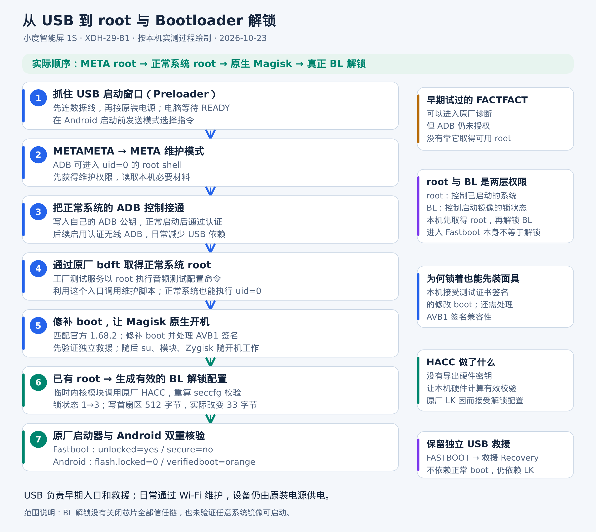

# 小度智能屏 1S：USB、root、Magisk 与 Bootloader 解锁

面向 **小度智能屏 1S / XDH-29-B1 / X7B_MAINBOARD_P3 / MT8167 / Android 8.1 ARM32** 的中文实录和工具包。**不是“小度在家1S”教程。**

已在一台自有设备完成：META root → 正常系统维护 root → 原生 Magisk 30.7 → 真正 BL 解锁。原厂 Fastboot 返回 `unlocked=yes`，正常系统返回 `ro.boot.flash.locked=0`、`verifiedbootstate=orange`。



## 先选需要的终点

| 目标 | 做到哪里 | 是否要刷分区 |
|---|---|---|
| 正常安装第三方应用、调试 | META → 添加自己的 ADB 公钥 → 正常 ADB | 不刷固件分区 |
| 正常系统执行 root 命令 | 再配置原厂 bdft 维护入口 | 不刷 boot/system/vendor |
| 开机 root、面具模块、Zygisk | 构建自己的救援 Recovery 和 Magisk boot | 写 recovery、boot |
| 真正解锁 Bootloader | 已有 root → HACC 回验 → 写本机 seccfg 首扇区 | 只在这一步写 seccfg |

**root 与 BL 解锁是两件事；本机先 root，后解锁。** 进入 Fastboot 也不代表锁已经打开。

## 下载与准备

下载本仓库源码 ZIP 或 Release 工具包，解压到一个单独目录。包内只有教程和脚本，不夹带其他设备的固件、校准分区或个人 ADB 密钥。

完整 USB 启动捕获和镜像构建首版支持 **Linux**；原始实机主机是 Debian 12。Ubuntu 的依赖安装方式类似，但没有宣称已做同机验证。Windows 可使用官方 ADB 做已授权后的基础操作；本版没有把未验证的 Windows / WSL USB 路径包装成“一键可用”。

需要：支持数据传输的 USB 线、原装电源、Python 3.10+，以及独占的一台目标设备。**USB 数据线不能代替原装供电。**

```bash
bash scripts/setup-linux.sh
.venv/bin/python xiaodu.py --help
```

安装脚本只在电脑安装依赖，不连接或刷写小度。以后示例中的 `python` 指 `.venv/bin/python`；也可以先运行 `source .venv/bin/activate`。

只接一台已授权设备时可省略 `--serial`；多台设备要明确指定：

```bash
python xiaodu.py --serial 设备序列号 doctor
python xiaodu.py --serial 设备IP:5555 doctor
```

USB 模式捕获需要 Linux USB 权限，可仅对 `meta` / `fastboot` 使用 `sudo .venv/bin/python …`。**后续 ADB 操作一直用同一个电脑用户**，避免换成另一套 ADB 密钥。

## 按顺序操作

1. [USB 接线、进入 META 与确认 root](docs/01-usb-meta.md)
2. [正常 ADB、原厂 bdft root、无线调试](docs/02-adb-root.md)
3. [自己的救援 Recovery、原生 Magisk 与启动验证](docs/03-magisk-rescue.md)
4. [HACC 原理、本机解锁配置生成、BL 核验](docs/04-bootloader.md)
5. [固件范围、失败分支与常见问题](docs/05-troubleshooting.md)
6. [原始实测与公开工具测试范围](docs/06-validation.md)

每个会改设备的命令都会在对应章节明确说明。写镜像和写锁配置需要显式 `--apply`，生成 HACC 校验需要 `--run-hacc`。没有“检测完就自动刷”的行为，不自动降级、不自动重启、不清 userdata、不重新上锁。

## 工具入口速查

```bash
python xiaodu.py doctor                       # 只读：型号、固件、主机依赖
python xiaodu.py meta                         # 等冷启动，发送METAMETA
python xiaodu.py meta-check                   # 核验META与root
python xiaodu.py authorize --apply            # 加当前电脑公钥，不关闭ADB认证
python xiaodu.py root-setup --apply           # 正常系统配置bdft维护入口
python xiaodu.py root 'id'                    # 正常系统执行root命令
python xiaodu.py backup                       # 只备份必要小型分区
python xiaodu.py wifi-adb --apply             # 开启保留密钥认证的无线ADB
python xiaodu.py fetch-tools                  # 下载并核验官方Magisk30.7
python xiaodu.py verify                       # 只读权限与BL属性
```

Magisk/救援/BL 的操作必须按相应章节完成前提，不能把这份速查当成无脑连续粘贴脚本。

## 精确适用范围

- 初始 USB/META/ADB/root 路线在本机原始 **1.69.3** 固件下走通，恢复到 **1.68.2** 后继续使用。
- **自动构建 Magisk boot 与 BL/HACC 工具严格限定** `DuerShow_MT8167s_v1.68.2.20250324172557685.R` 及对应内核/LK/模块 ABI。程序同时核对这些条件，不只看“1.68.2”短版本。
- 救援镜像使用读者自己的原版 Recovery、自己的 ADB 公钥，并严格检查待修补 adbd 的哈希。固件不同、二进制不同会停止。
- 本机曾通过官方 1.68.1 完整包与 1.68.2 差分恢复系统；**公开工具不自动降级或刷整包**。当前不是对应版本时，可先完成 ADB/维护 root，BL 阶段停住，不套用地址或他人的镜像。
- BL 解锁没有清数据；这不表示其他升级/降级/原厂恢复过程也会保留数据。操作启动分区可能造成无法启动，务必保留自己机器的必要备份及独立救援入口。

`work/` 保存本机备份、镜像、公钥、生成计划和检查结果，默认不进入 Git。**不要把整个 work 目录上传到 Issue。** 问题反馈只提供型号、完整固件版本、失败步骤、去除设备标识后的错误信息。

## 项目与第三方来源

本项目自编脚本采用 [MIT](LICENSE)。Magisk、Android Platform-Tools、MTKClient 等属于各自作者，详见 [NOTICE](NOTICE.md)。工具下载官方 Magisk APK 并校验固定 SHA256，没有把外部二进制作为自己的作品再分发。

公开版重构脚本的验证范围详见 [测试记录](docs/06-validation.md)：原方法实机成功不等于公开版每个写入分支又重新刷机验证，更不等于跨机器“一键成功”。
